# KSDB Studio

Gestionnaire de bases de données léger pour **PostgreSQL**, **MySQL** et **MariaDB**, sous **Windows**, **macOS** et **Linux**.
L’essentiel de Navicat, pgAdmin et DataGrip réuni dans une seule application, avec en plus le tunnel SSH, le VPN WireGuard et l’import des connexions Navicat.

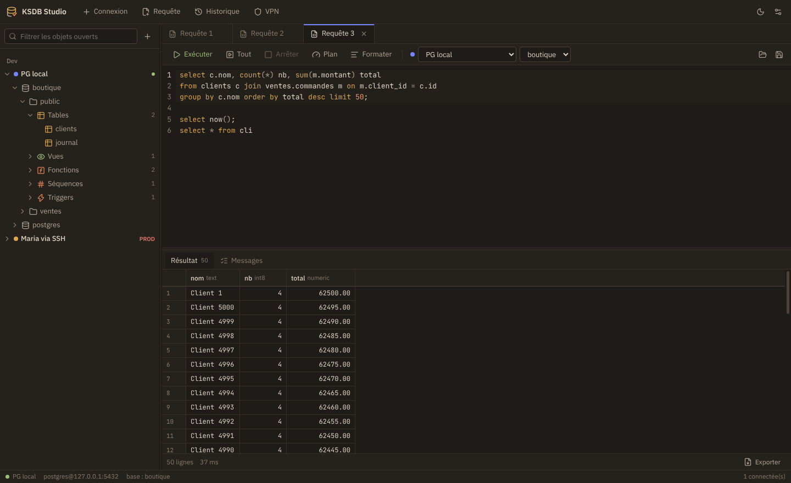

## Télécharger

Dernière version : [**Releases**](https://github.com/koyaja/KSDB-Studio/releases/latest)

| Système | Fichier |
|---|---|
| Windows 10 / 11 (64 bits) | `KSDB-Studio-Setup-<version>.exe` |
| Debian / Ubuntu | `KSDB-Studio-<version>-linux-amd64.deb` |
| Toute distribution Linux | `KSDB-Studio-<version>-linux-x86_64.AppImage` |
| macOS Apple Silicon (M1 à M4) | `KSDB-Studio-<version>-mac-arm64.dmg` |
| macOS Intel | `KSDB-Studio-<version>-mac-x64.dmg` |

### Installer sous Windows
Lance `KSDB-Studio-Setup-<version>.exe`. L’application n’est pas signée : Windows SmartScreen affiche un avertissement, clique sur **Informations complémentaires** puis **Exécuter quand même**.

### Installer sous macOS
Ouvre le `.dmg` et glisse **KSDB Studio** dans **Applications**. L’application n’est pas notariée par Apple : au premier lancement, macOS la bloque.
- Ouvre **Réglages Système → Confidentialité et sécurité**, puis **Ouvrir quand même** en face de KSDB Studio ;
- ou, si macOS indique que l’application est « endommagée » :

```bash
xattr -cr "/Applications/KSDB Studio.app"
```

Outils de sauvegarde : `brew install libpq mysql-client` (ou Postgres.app). VPN : tunnels de l’application WireGuard de l’App Store, ou `brew install wireguard-tools` pour un fichier `.conf`.

### Installer sous Linux

```bash
# Debian / Ubuntu
sudo apt install ./KSDB-Studio-<version>-linux-amd64.deb
ksdb-studio

# AppImage (toutes distributions)
chmod +x KSDB-Studio-<version>-linux-x86_64.AppImage
./KSDB-Studio-<version>-linux-x86_64.AppImage
# Ubuntu 22.04+ : sudo apt install libfuse2t64   (ou libfuse2)
# Erreur « sandbox » sur Ubuntu 24.04 : ajouter --no-sandbox
```

## Fonctionnalités

| Domaine | Ce qui est inclus |
|---|---|
| Connexions | PostgreSQL, MySQL, MariaDB ; groupes et couleurs ; **tunnel SSH** (mot de passe ou clé + phrase de passe) ; SSL (requis / vérifié) ; mots de passe chiffrés par le système (DPAPI sous Windows, trousseau sous Linux) ; mode **lecture seule** ; mode **production** (confirmation avant DROP, TRUNCATE, DELETE/UPDATE sans WHERE) |
| VPN WireGuard | Profils VPN (fichier `.conf` importé et chiffré, ou tunnel déjà installé) associés à une **connexion** ou à un **groupe** ; **démarrage automatique** avant la connexion ; démarrer / arrêter depuis l’arbre ou la barre du haut |
| Migration | **Import des connexions Navicat (`.ncx`)**, mots de passe compris ; export / import de connexions au format KSDB |
| Navigation | Bases → schémas → tables, vues, vues matérialisées, fonctions, procédures, séquences, triggers ; filtre ; menus contextuels (créer, renommer, vider, supprimer…) |
| Éditeur SQL | Onglets restaurés au redémarrage ; **autocomplétion des tables et colonnes** ; exécution de l’instruction courante (Ctrl+Entrée) ou du script (F5) ; sessions persistantes (BEGIN / COMMIT sur plusieurs exécutions) ; **annulation** ; EXPLAIN / EXPLAIN ANALYZE ; formatage ; fichiers `.sql` ; historique |
| Données | Grille virtualisée ; pagination ; tri multi-colonnes ; filtre WHERE ; **édition directe** ; ajout / suppression de lignes ; aperçu du SQL ; enregistrement **dans une transaction** ; copie TSV ou INSERT ; éditeur de valeur (JSON formaté) |
| Structure | Colonnes, index, clés étrangères, DDL ; **concepteur de table** (création et modification) avec le SQL généré visible |
| Diagramme ERD | Diagramme automatique d’un schéma (tables, colonnes, PK/FK, nombre de lignes, relations en pattes de corbeau) ; zoom, déplacement, tables repositionnables (positions mémorisées) ; clic pour mettre en évidence les relations ; recherche ; affichage complet / clés / noms ; requête avec jointures générée ; export **PNG** et **SVG** |
| Comparaison de schémas | Source ↔ cible (bases, schémas, connexions différentes, ex. dev → prod) : tables, colonnes, clés primaires, index, contraintes UNIQUE, clés étrangères, commentaires, vues, vues matérialisées, fonctions, procédures, triggers ; détail des différences et avertissements (perte de données, NOT NULL…) ; **script de migration** ordonné (FK, vues dépendantes supprimées puis recréées dans l’ordre) ; suppressions décochées par défaut ; ouvrir dans l’éditeur, enregistrer en .sql ou **appliquer sur la cible** (transaction sous PostgreSQL) |
| Transfert de données | Copie de tables entre bases, schémas ou **serveurs différents**, y compris **PostgreSQL ↔ MySQL/MariaDB** (tunnels SSH et VPN compris) : lecture en flux, insertion par lots, ordre des clés étrangères ; création ou recréation des tables (même moteur), vidage préalable, filtre WHERE par table, doublons ignorés, séquences recalées ; une transaction par table, progression en direct et arrêt possible |
| Import / export | Export de table complète en CSV, TSV, JSON, SQL INSERT ; export des résultats ; **import CSV** (séparateur détecté, encodage, correspondance des colonnes, transaction unique) |
| Sauvegarde | **Dump / restauration** via pg_dump, pg_restore, psql, mysqldump, mysql (détectés automatiquement), y compris à travers un tunnel SSH ou un VPN |
| Serveur | Sessions actives, annulation de requête, fin de session |
| Mises à jour | Version affichée (barre d’état, À propos) ; vérification des nouvelles releases GitHub au démarrage puis toutes les 6 h ; notification système ; téléchargement du bon fichier (installateur Windows, AppImage, .deb) avec installation en un clic sous Windows et AppImage ; « ignorer cette version » |
| Thèmes | **Papier** (clair chaud) et **Nuit douce** (sombre chaud, peu de bleu) pour le confort visuel, plus Clair et Sombre ; bascule **selon l’heure** ou selon le système |

| | |
|---|---|
| 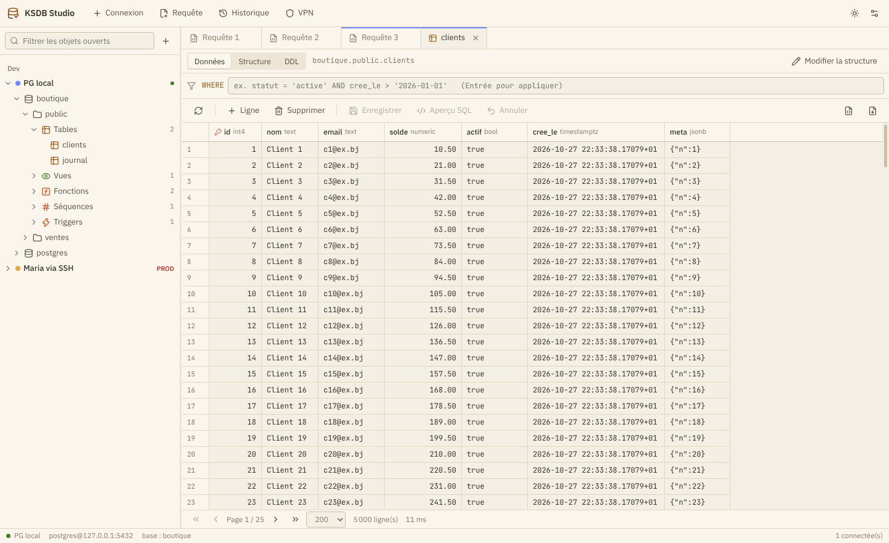 | 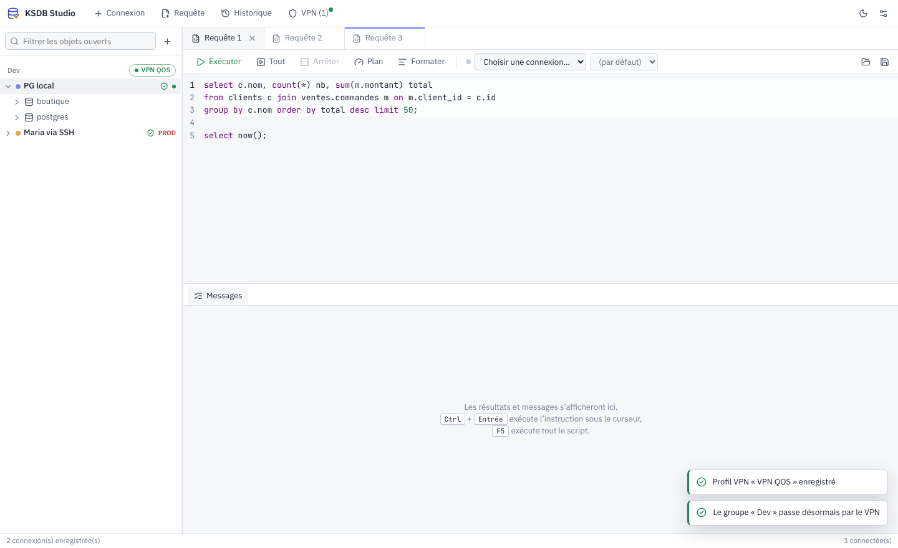 |
| 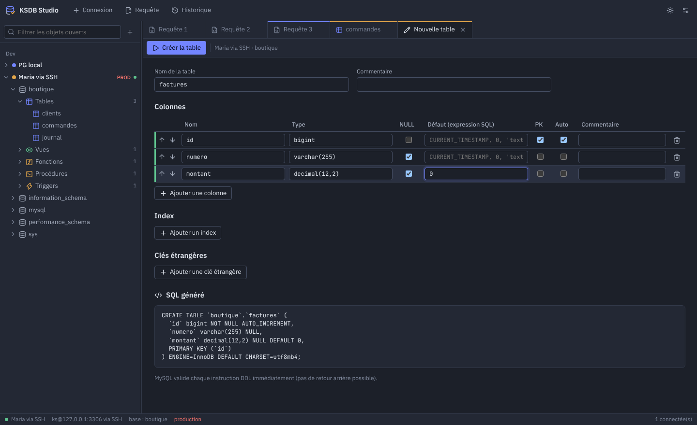 | 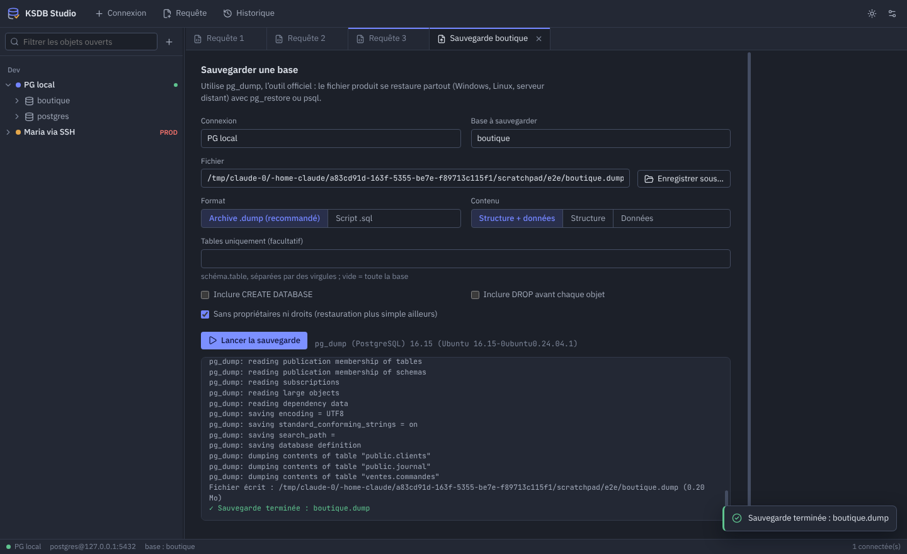 |
| 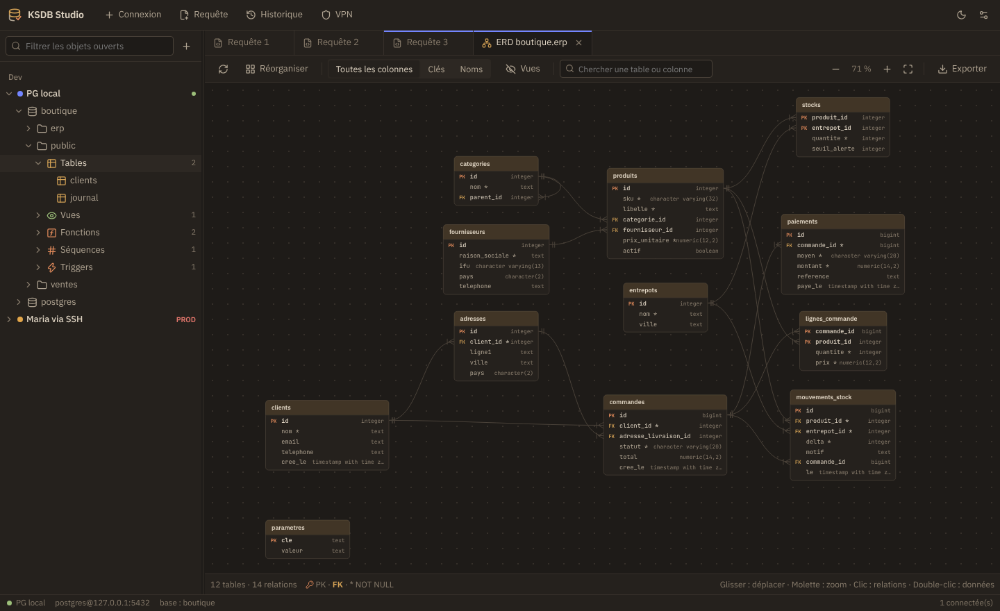 | 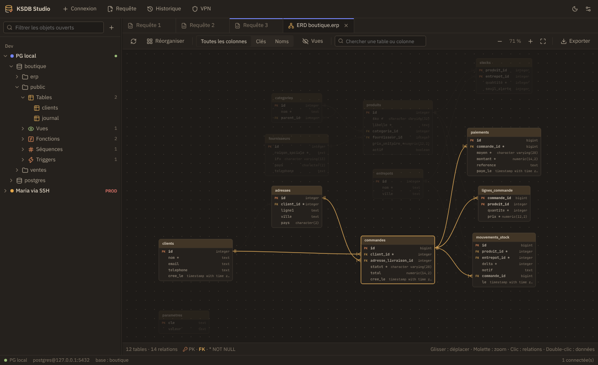 |
| 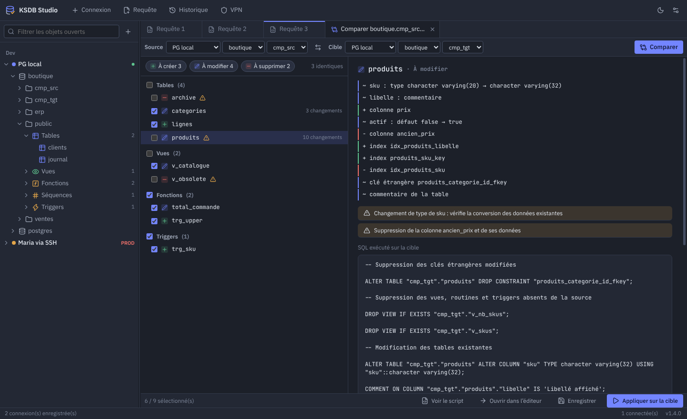 | 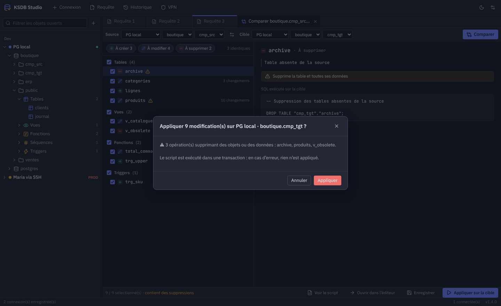 |
| 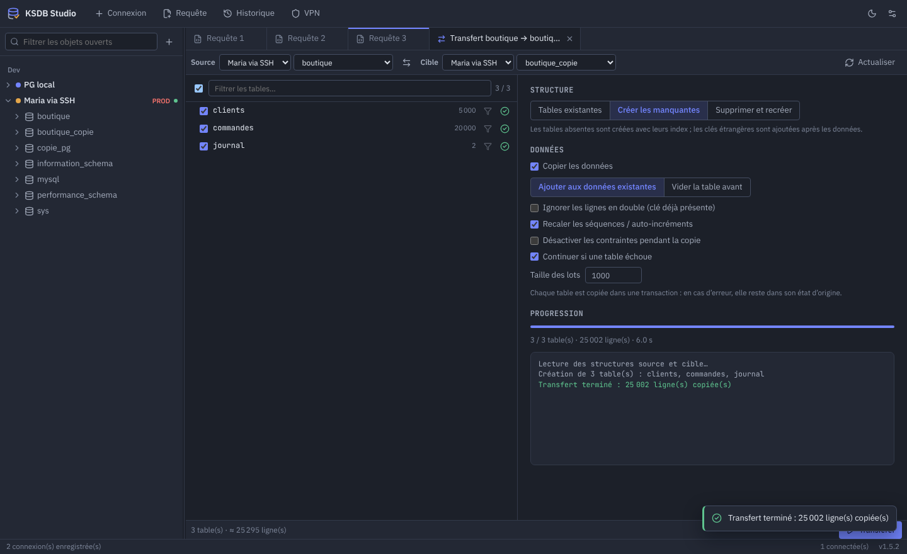 | 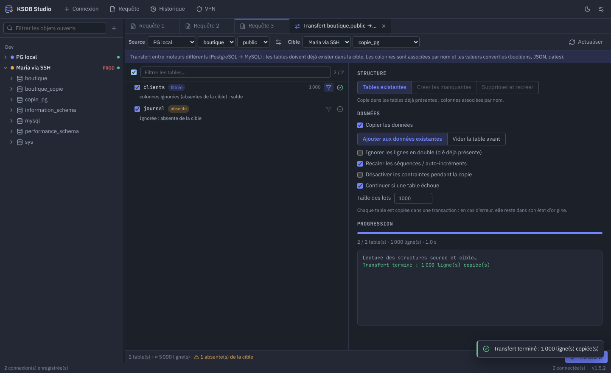 |

## Migrer depuis Navicat

1. Dans Navicat : **Fichier → Exporter les connexions…**, coche **Exporter le mot de passe**, enregistre le `.ncx`.
2. Dans KSDB Studio : écran d’accueil → **Importer depuis Navicat** (ou Paramètres → Connexions).
3. Les connexions PostgreSQL, MySQL et MariaDB sont importées dans le groupe « Navicat », avec mots de passe et tunnels SSH. Corrige les chemins de clés SSH si tu changes de système.

## Comparer et synchroniser deux schémas

1. Clic droit sur un schéma (PostgreSQL) ou une base (MySQL / MariaDB) → **Comparer avec…** : c’est la **source** (la référence, par exemple dev).
2. Choisis la **cible** (celle à mettre à jour, par exemple prod), sur la même connexion ou une autre, puis **Comparer**.
3. Coche les objets à synchroniser. Les suppressions (tables, colonnes, vues absentes de la source) sont décochées par défaut.
4. **Voir le script**, **Ouvrir dans l’éditeur**, **Enregistrer** en .sql, ou **Appliquer sur la cible**. Sous PostgreSQL le script s’exécute dans une transaction ; sous MySQL les instructions de structure sont validées une à une : fais une sauvegarde avant.

## Transférer des données entre serveurs

1. Clic droit sur un schéma (PostgreSQL), une base (MySQL / MariaDB) ou une table → **Transférer les données…** : c’est la **source**.
2. Choisis la **cible** : même serveur ou autre serveur, même moteur ou non.
3. Coche les tables ; l’icône d’entonnoir ajoute un filtre `WHERE` à une table.
4. Structure :
   - **Tables existantes** : copie dans les tables déjà présentes, colonnes associées par nom (seul mode possible entre PostgreSQL et MySQL) ;
   - **Créer les manquantes** : crée les tables absentes avec leurs index, puis les clés étrangères après les données ;
   - **Supprimer et recréer** : remplace les tables de la cible par celles de la source.
5. Options : vider avant, ignorer les doublons, recaler séquences et auto-incréments, désactiver les contraintes, continuer après une erreur, taille des lots.
6. **Transférer**. Chaque table est copiée dans sa propre transaction : une table en erreur reste dans son état d’origine.

Entre moteurs, les valeurs sont converties : booléens, JSON, dates avec fuseau horaire (converties dans le fuseau de la connexion MySQL), binaires.

## VPN WireGuard

1. Installe WireGuard : Windows → [wireguard.com/install](https://www.wireguard.com/install/) ; Linux → `sudo apt install wireguard-tools` (NetworkManager le gère nativement).
2. Bouton **VPN** en haut → **Nouveau profil** → importe le `.conf`, ou indique le nom d’un tunnel déjà présent dans l’application WireGuard / NetworkManager.
3. Clic droit sur un groupe → **Associer un VPN au groupe…**, ou onglet **VPN** d’une connexion. Une connexion peut choisir « Aucun » pour ignorer le VPN de son groupe.
4. À l’ouverture de la connexion, le tunnel démarre ; la pastille du groupe passe au vert. Un clic dessus l’arrête (les connexions qui en dépendent sont fermées).

Windows demande une autorisation administrateur (UAC) à chaque démarrage ou arrêt, car c’est le service WireGuard qui crée la carte réseau. Sous Linux, NetworkManager ne demande rien ; sans lui, `wg-quick` passe par `pkexec`.

## Outils de sauvegarde

- Windows : « Command Line Tools » de PostgreSQL (installateur EDB) et/ou MySQL / MariaDB. Détectés dans `C:\Program Files\PostgreSQL\<version>\bin`, `C:\Program Files\MySQL\…`, `C:\Program Files\MariaDB …`, XAMPP, WAMP et Laragon.
- Linux : `sudo apt install postgresql-client mariadb-client`.

`pg_dump` doit être de la même version majeure que le serveur, ou plus récente. Un chemin précis se règle dans **Paramètres → Outils de sauvegarde**.

## Publier une version

1. Ajouter une section `## [X.Y.Z]` en tête de `CHANGELOG.md` (elle devient les notes de la release).
2. Passer `version` à `X.Y.Z` dans `package.json` et pousser sur `main`.
3. GitHub Actions crée le tag `vX.Y.Z` et la release, compile Windows, Linux et macOS et joint les fichiers (10 à 15 min). Les installations existantes sont prévenues automatiquement.

Un push sans changement de version ne publie rien (simple compilation de vérification). Pour compléter une release dont une compilation a échoué : **Actions → Build KSDB Studio → Run workflow** avec le tag.

## Développement

Prérequis : Node.js 22.

```bash
npm install
npm run dev          # Vite + Electron avec rechargement
npm run typecheck
npm start            # build + lancement
npm run test:engine  # tests d'intégration sur de vraies bases PostgreSQL / MariaDB
npm run test:vpn     # pilotage WireGuard (commandes système simulées, Windows + Linux)
npm run test:update  # détection et téléchargement des mises à jour
npm run test:compare # comparaison de schémas : diff → script appliqué → nouveau diff vide (PG + MariaDB)
npm run test:transfer # transfert de données : PG → PG, MariaDB → MariaDB, PG ↔ MariaDB
npm run dist:linux   # AppImage + .deb dans release/
npm run dist:win     # installateur Windows dans release/
npm run dist:mac     # .dmg Apple Silicon + Intel dans release/ (sur un Mac)
```

Les tests moteur visent par défaut PostgreSQL `postgres/secret@127.0.0.1:5432` et MariaDB `ks/secret@127.0.0.1:3306` avec une base `boutique`. Variables : `KSDB_PG_HOST`, `KSDB_PG_PORT`, `KSDB_PG_USER`, `KSDB_PG_PASS`, `KSDB_MY_PORT`, `KSDB_MY_USER`, `KSDB_MY_PASS`, `KSDB_SSH_PORT`, `KSDB_SSH_KEY`.

Le workflow GitHub Actions `.github/workflows/build.yml` compile Windows, Linux et macOS à chaque tag `v*` et joint les fichiers à la release.

### Architecture

```
src/
  shared/          types communs, découpage SQL (chaînes, commentaires, $$, DELIMITER)
  main/            process Electron (Node)
    drivers/       postgres.ts (pg + pg-cursor), mysql.ts (mysql2), base.ts
    connections.ts pools, sessions par onglet, tunnel SSH, démarrage du VPN
    tunnel.ts      ssh2 → port local
    vpn.ts         WireGuard : wireguard.exe (UAC) / nmcli / wg-quick / scutil (macOS)
    transfer.ts    transfert de données entre connexions (flux, lots, ordre des FK)
    tools.ts       pg_dump / pg_restore / psql / mysqldump / mysql
    navicat.ts     import .ncx (AES-128-CBC Navicat 12+)
    csv.ts         lecture / écriture CSV en flux
    store.ts       connexions et VPN (secrets via safeStorage), paramètres, historique
    ipc.ts         API exposée à l’interface
  preload/         pont sécurisé (contextIsolation, sandbox)
  renderer/        React + CodeMirror 6 + grille virtualisée
```

Données locales : `%APPDATA%\KSDB Studio\data` (Windows), `~/.config/KSDB Studio/data` (Linux), `~/Library/Application Support/KSDB Studio/data` (macOS).

## Feuille de route

- Gestion des utilisateurs et des droits
- Plan EXPLAIN visuel
- Sauvegardes planifiées
- SQL Server, SQLite, MongoDB

---

© CYBERISK
